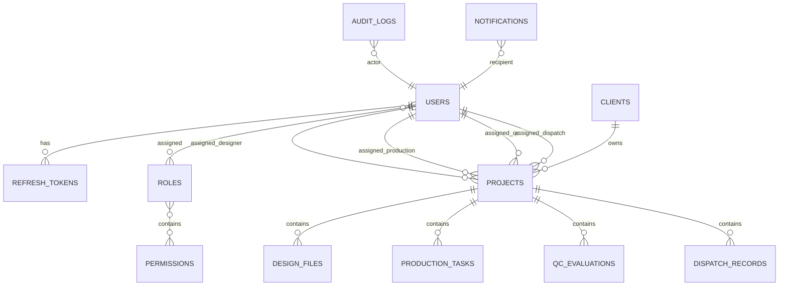

# Database Schema & Data Models — Rohilla Advertising CRM

## 1. Entity-Relationship Overview

---

## 2. Core Tables & Schema Specifications

### `users`
* `id` (UUID, Primary Key)
* `email` (VARCHAR(150), Unique, Indexed)
* `password` (VARCHAR(255), BCrypt Encrypted)
* `full_name` (VARCHAR(100))
* `phone` (VARCHAR(20))
* `department` (VARCHAR(50) — `MANAGEMENT`, `DESIGN`, `PRODUCTION`, `QUALITY_CONTROL`, `DISPATCH`)
* `status` (VARCHAR(20) — `ACTIVE`, `INACTIVE`, `SUSPENDED`)
* `created_at`, `updated_at` (TIMESTAMP)

### `projects`
* `id` (UUID, Primary Key)
* `project_code` (VARCHAR(50), Unique, e.g. `PRJ-2026-001`)
* `title` (VARCHAR(200))
* `client_id` (UUID, Foreign Key -> `clients`)
* `status` (VARCHAR(50) — finite state machine status)
* `priority` (VARCHAR(20) — `LOW`, `MEDIUM`, `HIGH`, `URGENT`)
* `customer_provided_design` (BOOLEAN — Path A vs Path B)
* `installation_required` (BOOLEAN)
* `due_date` (TIMESTAMP)
* `budget` (DECIMAL(12, 2))
* `assigned_designer_id`, `assigned_production_id`, `assigned_qc_id`, `assigned_dispatch_id` (UUID, Foreign Keys -> `users`)
* `created_at`, `updated_at` (TIMESTAMP)

### `design_files`
* `id` (UUID, Primary Key)
* `project_id` (UUID, Foreign Key -> `projects`)
* `original_file_name` (VARCHAR(255))
* `storage_key` (VARCHAR(500) — `projects/{projectId}/design/{uuid}_{name}`)
* `file_size_bytes` (BIGINT)
* `mime_type` (VARCHAR(100))
* `version_number` (INTEGER, e.g. 1, 2, 3)
* `uploaded_by_id` (UUID, Foreign Key -> `users`)
* `is_production_approved`, `is_locked` (BOOLEAN)
* `technical_check_passed` (BOOLEAN)
* `approved_by_customer` (BOOLEAN)
* `created_at` (TIMESTAMP)

### `production_tasks`
* `id` (UUID, Primary Key)
* `project_id` (UUID, Foreign Key -> `projects`)
* `task_name` (VARCHAR(150))
* `machine_type` (VARCHAR(100))
* `material_specification` (VARCHAR(255))
* `quantity` (INTEGER)
* `status` (VARCHAR(50))
* `started_at`, `completed_at` (TIMESTAMP)
* `assigned_to_id` (UUID, Foreign Key -> `users`)

### `qc_evaluations`
* `id` (UUID, Primary Key)
* `project_id` (UUID, Foreign Key -> `projects`)
* `inspector_id` (UUID, Foreign Key -> `users`)
* `passed` (BOOLEAN)
* `color_accuracy_score`, `dimension_accuracy_score`, `finishing_score` (DECIMAL(4, 2))
* `remarks`, `defects_notes` (TEXT)
* `created_at` (TIMESTAMP)

### `dispatch_records`
* `id` (UUID, Primary Key)
* `project_id` (UUID, Foreign Key -> `projects`)
* `dispatch_date` (TIMESTAMP)
* `courier_partner` (VARCHAR(100))
* `tracking_number` (VARCHAR(100))
* `recipient_name`, `destination_address` (VARCHAR(255))
* `dispatched_by_id` (UUID, Foreign Key -> `users`)
* `created_at` (TIMESTAMP)

### `audit_logs`
* `id` (UUID, Primary Key)
* `actor_id` (UUID), `actor_email` (VARCHAR(150)), `actor_role` (VARCHAR(50))
* `action` (VARCHAR(100) — `AuditAction` enum)
* `resource_type` (VARCHAR(50)), `resource_id` (VARCHAR(100))
* `old_value`, `new_value` (TEXT)
* `ip_address` (VARCHAR(50)), `user_agent` (VARCHAR(255))
* `created_at` (TIMESTAMP)
