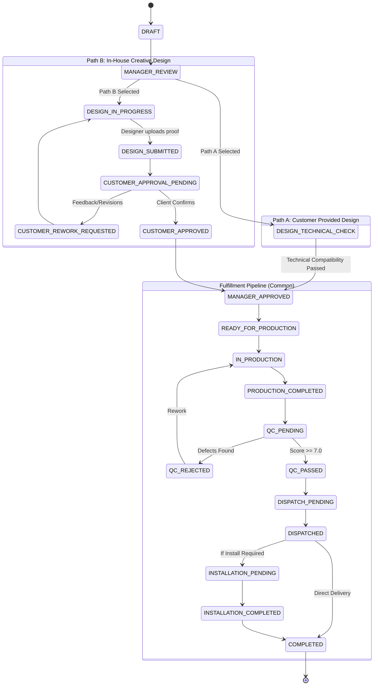

# Project Lifecycle & Finite State Machine — Rohilla Advertising CRM

## 1. Dual-Path Architecture (Path A vs Path B)

Rohilla Advertising CRM supports two distinct design intake workflows:

---

## 2. Stage Breakdown & Operational Hand-Offs

### Stage 1: Intake & Manager Review
* Project created by Manager/Admin.
* Selection of Path A (Customer Artwork) or Path B (In-House Design).

### Stage 2: Design Verification / Creation
* **Path A**: Designer inspects file dimensions, CMYK color space, bleed margins, and resolution. Marks technical check passed.
* **Path B**: Designer creates vector artwork, uploads versions (`v1`, `v2`...). Version locked upon customer approval.

### Stage 3: Manager Operational Approval
* Manager reviews specifications, verifies customer sign-off, and marks project `READY_FOR_PRODUCTION`.

### Stage 4: Production Run
* Print Master schedules job on assigned machines (e.g. UV Flatbed, Eco-Solvent, Laser CNC, Acrylic Bender).
* Job tracked from `IN_PRODUCTION` to `PRODUCTION_COMPLETED`.

### Stage 5: Quality Control Inspection
* QC Inspector performs physical inspection with a 10-point scoring rubric:
  * Color Accuracy Score (/10)
  * Dimension Accuracy Score (/10)
  * Finishing Score (/10)
* Passing threshold >= 7.0/10 moves project to `QC_PASSED`. Failures trigger `QC_REJECTED` and routed back for rework.

### Stage 6: Dispatch & Logistics
* Logistics Lead generates packing slip, assigns courier partner/vehicle, and inputs tracking number.
* Project transitions to `DISPATCHED`.

### Stage 7: Installation & Handover
* If `installationRequired = true`, field technicians complete on-site mounting, collect customer signature, and transition project to `INSTALLATION_COMPLETED`.

### Stage 8: Manager Final Closure
* Manager completes final invoice audit and marks project `COMPLETED`.
